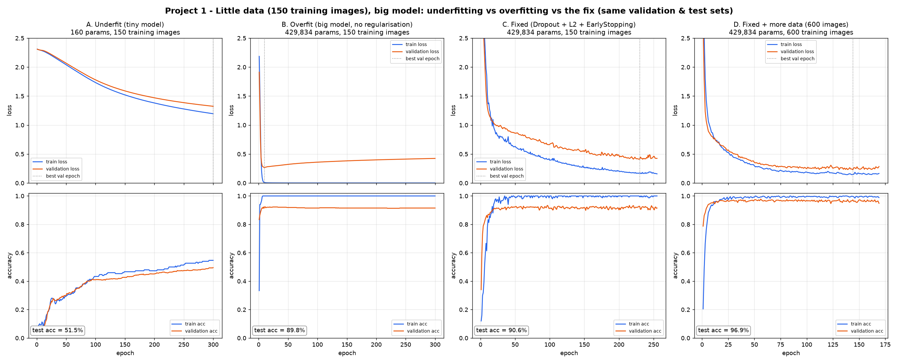

# Project 1 · Little data, big model

**Client:** Courier company
**You will see:** underfitting, overfitting and the fix, on real learning curves.

## 1. The problem

A courier company wants to read the handwritten digits that drivers write on parcel labels
(house numbers, postcodes). They only have a **small labelled dataset**: 150 images, 15 per digit.
A big neural network on little data tends to *memorise* rather than *learn*. The goal is to show
that happening in the curves, and then fix it.

## 2. Objectives

1. Train a model that is **too small**, and recognise **underfitting** in the curves.
2. Train a **big model with no regularisation**, and recognise **overfitting**.
3. Apply the standard fixes (**Dropout, L2 weight decay, EarlyStopping**) and compare.
4. Show what actually moves the needle with little data: **more labelled data**.
5. Save all the learning curves as **`curves.png`**.

## 3. Workflow (designed on paper first)

```
 sklearn digits (1,797 × 8×8 images)
        │  stratified split (fixed seed)
        ├── test 30%  (540) ──────────────┐  identical for every experiment
        ├── validation ~30% (541) ────────┤
        └── training pool (~716)          │
              │ take 150 (or 600 for D)   │
              ▼                           │
   ┌─────────────────────────────────┐    │
   │ A tiny   B big   C big+reg  D C+data │
   └─────────────────────────────────┘    │
              │ fit, record loss/acc per epoch
              ▼                           │
      diagnose curves  ◄──────────────────┘ evaluate on test
              │
              ▼
     curves.png + results.json
```

## 4. Implementation

All code is in [`train.py`](train.py) (TensorFlow/Keras + scikit-learn).

| Experiment | Model | Regularisation | Training images |
|---|---|---|---|
| **A. Underfit** | Flatten → Dense(2) → Dense(10): **160 weights** | none | 150 |
| **B. Overfit** | Flatten → Dense(512) → Dense(512) → Dense(256) → Dense(10): **429,834 weights** | none, 300 epochs | 150 |
| **C. Fixed** | same as B | Dropout 0.5, L2 = 1e-3, EarlyStopping (patience 25, restore best weights) | 150 |
| **D. Fixed + more data** | same as C | same as C | **600** |

Details:
* Pixels scaled from 0–16 to 0–1. Adam (lr 1e-3), sparse categorical cross-entropy, batch 32.
* `keras.utils.set_random_seed(42)` before every model, so all of them start from the same point.
* Validation and test sets are **the same for all four experiments**, so the numbers are directly comparable.
* A small `diagnose()` function reads the curves the way we did in class
  (low training accuracy means underfitting; validation loss climbing well above its best while training loss falls means overfitting).

## 5. How to run

From the `Assignment_3` folder:

```bash
pip install -r requirements.txt
cd project1_little_data_big_model
python train.py            # full run, ~1–2 minutes on a laptop CPU
python train.py --quick    # 20-epoch smoke test
```

Outputs: `curves.png` and `results.json` in this folder.

## 6. Results



| Experiment | Weights | Train imgs | Epochs | Train acc | **Test acc** | Best val loss (epoch) | Final val loss | Diagnosis |
|---|---:|---:|---:|---:|---:|---|---:|---|
| A. Underfit | 160 | 150 | 300 | 55.3% | **51.5%** | 1.324 (300) | 1.324 | Underfitting |
| B. Overfit | 429,834 | 150 | 300 | 100% | **89.8%** | 0.270 (10) | 0.425 | Overfitting (+58% above best) |
| C. Fixed | 429,834 | 150 | 255 (early stop) | 100% | **90.6%** | 0.411 (230) | 0.425 | Good fit |
| D. Fixed + more data | 429,834 | 600 | 169 (early stop) | 100% | **96.9%** | 0.230 (144) | 0.284 | Good fit |

*(Exact numbers are in [`results.json`](results.json) and can shift slightly between machines.)*

### Reading the curves

* **A – Underfitting.** Train and validation loss sit on top of each other and stay high (around 1.3).
  A 2-neuron bottleneck simply cannot separate 10 classes. Training longer doesn't help; the model needs capacity.
* **B – Overfitting.** Training loss falls to ~0 and training accuracy hits 100% within a few epochs.
  Validation loss bottoms out at **epoch 10** and then climbs steadily for the next 290 epochs.
  The model is memorising the 150 images.
* **C – The fix.** With Dropout, L2 and EarlyStopping the validation loss no longer turns upward.
  It keeps improving slowly, and EarlyStopping keeps the best weights. Test accuracy goes up a little (89.8% → 90.6%),
  and the model is now *safe to train*: it no longer gets worse the longer you train it.
  (Its loss values are higher than B's partly because they include the L2 penalty.)
* **D – More data is the bigger lever.** Same regularised model with 600 images instead of 150:
  test accuracy jumps to **96.9%** and validation loss reaches its lowest value of all four runs.

**Conclusion for the client:** regularisation stops the big model from memorising, but with only
150 labels accuracy plateaus around 90%. Labelling a few hundred more parcels (or augmenting the
existing ones, see Project 3) is worth more than any further tuning.

## 7. Limitations

* The digits are **8×8 scikit-learn images**, much cleaner and smaller than real parcel photos.
  A real system would need cropping, de-skewing and a CNN on higher-resolution images.
* Results come from **one random seed and one split**. A fair comparison would average several seeds
  or use cross-validation; the C vs B gap (0.8 points) is within seed-to-seed noise.
* A dense network ignores the 2-D structure of images; a small CNN would do better with the same data.
* No augmentation was used here on purpose, to isolate the effect of regularisation and data size.
