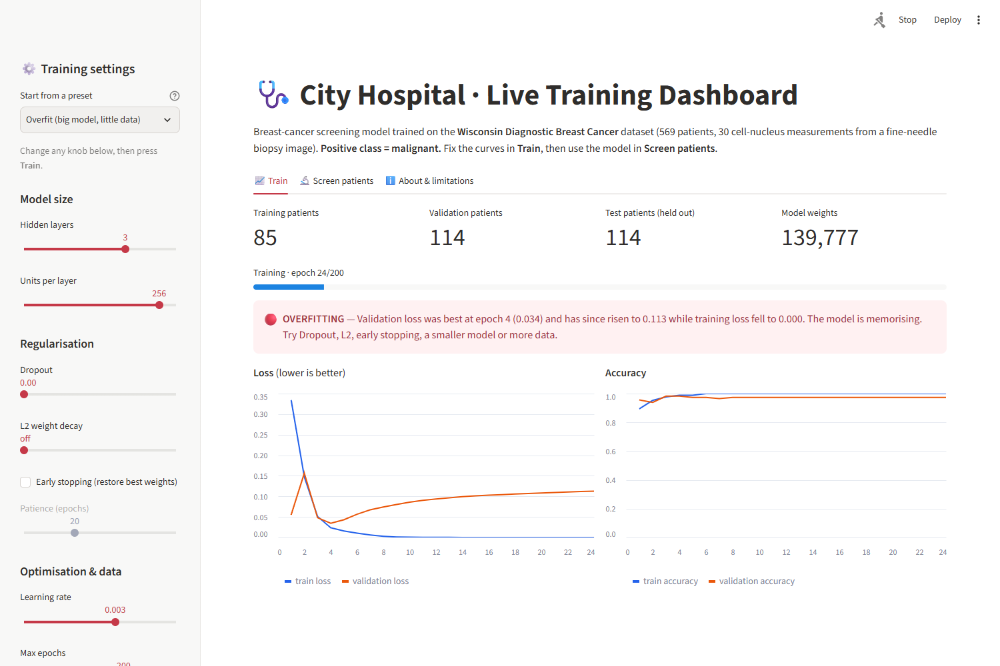
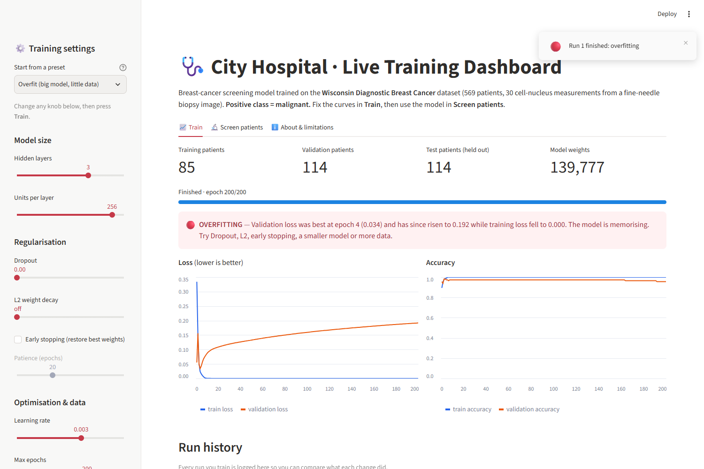
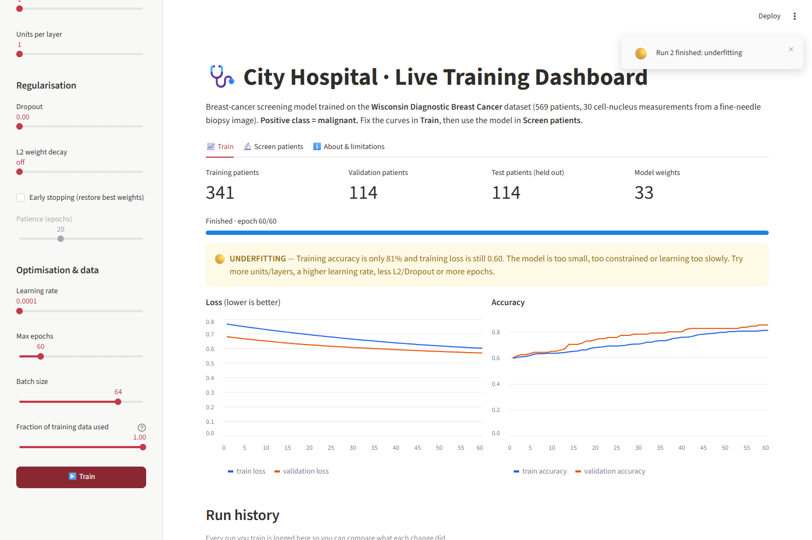
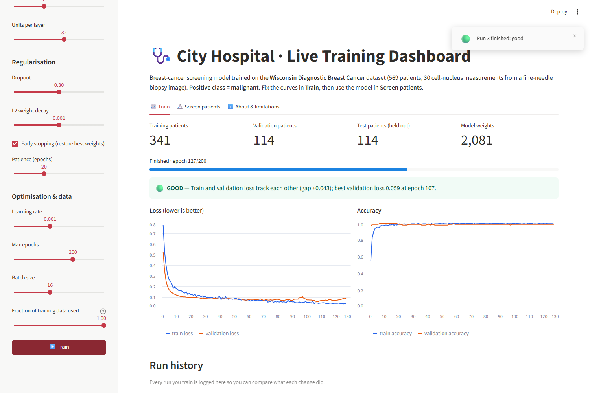
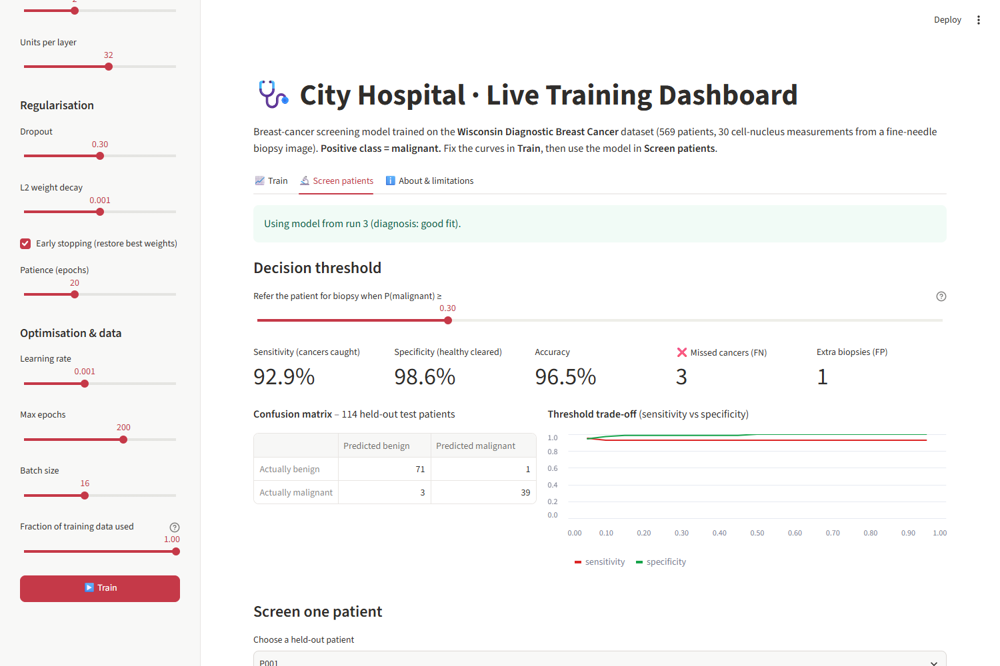
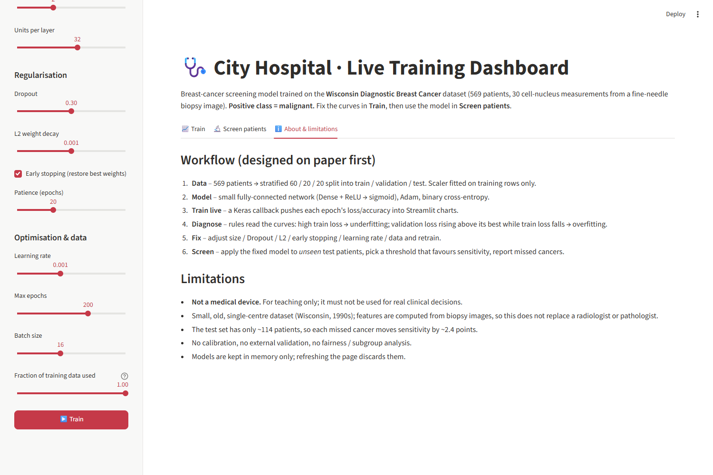

# Project 5 · Live training dashboard

**Client:** City Hospital
**You will see:** the curves being fixed live in Streamlit, then the model screening real (held-out) patients.

## 1. The problem

City Hospital wants a tool their team can use to **train a breast-cancer screening model and watch
it learn**: see underfitting and overfitting appear in the curves as they happen, change the
settings until the curves look healthy, and then use that model to screen patients. In screening,
a **missed cancer (false negative)** is far more costly than an extra biopsy (false positive), so the
tool must report sensitivity and missed cancers, not just accuracy.

## 2. Objectives

1. A Streamlit dashboard where every training setting is a knob (size, Dropout, L2, early stopping,
   learning rate, epochs, batch size, amount of data).
2. **Live curves.** Loss and accuracy redraw *during* training via a Keras callback.
3. **Automatic diagnosis** of underfitting / overfitting / good fit, updated live.
4. Presets that reproduce each curve shape from class, plus a **run history** to compare changes.
5. A **screening tab**: adjustable decision threshold, sensitivity / specificity / missed cancers,
   confusion matrix, per-patient recommendation, batch CSV screening and download.
6. Clear documentation of the **limitations**.

## 3. Workflow (designed on paper first)

```
Wisconsin breast-cancer data (569 patients × 30 features, label 1 = malignant)
   │ stratified 60 / 20 / 20 split  →  train 341 │ validation 114 │ test 114 (never trained on)
   │ StandardScaler fitted on TRAIN only
   ▼
┌───────────── Sidebar knobs / preset ─────────────┐
│ layers · units · dropout · L2 · early stopping   │
│ learning rate · epochs · batch · data fraction   │
└──────────────────────┬───────────────────────────┘
                       ▼ press Train
   Keras model.fit ──► LiveCurves callback (every epoch)
                       ├─► loss chart, accuracy chart, progress bar
                       └─► diagnose(history) → UNDERFITTING / OVERFITTING / GOOD
                       ▼
   Run saved to history; model kept in session
                       ▼
   Screen patients tab: threshold → metrics on 114 unseen test patients
                       → single-patient recommendation → batch CSV screening
```

## 4. Implementation

| File | What it does |
|---|---|
| [`trainer.py`](trainer.py) | Data loading and splitting, `TrainConfig` + the three presets, model builder (Dense + ReLU + Dropout + L2 → sigmoid), `train()`, `diagnose()` curve reader, `screening_metrics()`. No Streamlit code, so it can be tested on its own (`python trainer.py`). |
| [`app.py`](app.py) | The Streamlit dashboard: sidebar knobs, live-curve Keras callback, run history, screening tab, about tab. |
| [`../scripts/capture_screenshots.py`](../scripts/capture_screenshots.py) | Drives the running app in Microsoft Edge with Playwright and saves the screenshots below. |

Key design points:
* **Live curves.** `StreamlitLiveCurves(keras.callbacks.Callback)` appends each epoch's logs and
  redraws `st.empty()` placeholders, at most ~60 times per run, so the browser keeps up.
* **Diagnosis rules.** Training accuracy < 90% with training loss > 0.25 means *underfitting*.
  Final validation loss > 1.3 × its best, with a train/validation gap > 0.1, means *overfitting*.
  Anything else is a *good fit*.
* **Presets.** *Underfit* (1 unit, lr 1e-4), *Overfit* (3 × 256 units, no regularisation, 25% of the
  data, 200 epochs), and *Fixed* (2 × 32 units, Dropout 0.3, L2 1e-3, early stopping, all the data).
* **No leakage.** The scaler is fitted on training rows only. The test patients are used only in
  the screening tab.
* **Recall is tracked** as a Keras metric during training, because sensitivity is what matters clinically.
* **Screening threshold** defaults to **0.30**, not 0.5, to favour catching cancers. A live
  sensitivity/specificity trade-off chart shows the cost of moving it.

## 5. How to run

From the `Assignment_3` folder:

```bash
pip install -r requirements.txt
cd project5_live_training_dashboard
streamlit run app.py            # opens http://localhost:8501
```

1. In the sidebar pick a preset (start with **Overfit**) and press **▶️ Train**. Watch the curves draw.
2. Switch to **Fixed**, or change the knobs yourself, and train again until the diagnosis is 🟢 GOOD.
3. Open **🔬 Screen patients**, set the threshold and inspect patients.

Optional command-line check (no browser): `python trainer.py` trains all three presets and prints the diagnosis and test metrics.

To regenerate the screenshots (with the app running): `python ../scripts/capture_screenshots.py`.

## 6. Results

### Live training: overfitting caught as it happens


### Overfit preset: validation loss turns upward after epoch 4


### Underfit preset: both curves stay high


### Fixed preset: curves track each other, early stopping at epoch 127


### Screening the 114 held-out patients (threshold 0.30)


### About & limitations tab


| Preset | Training patients | Epochs | Diagnosis | Test accuracy | Sensitivity | Missed cancers (thr 0.5) |
|---|---:|---:|---|---:|---:|---:|
| Underfit | 341 | 60 | 🟡 Underfitting (train acc 81%, loss 0.60) | 77.2% | 81.0% | 8 |
| Overfit | 85 | 200 | 🔴 Overfitting (val loss 0.034 at epoch 4 → 0.192) | 97.4% | 92.9% | 3 |
| **Fixed** | 341 | 127 (early stop) | 🟢 Good fit (gap +0.043) | **97.4%** | **92.9%** | **3** |

Screening with the **Fixed** model at threshold **0.30**, on 114 unseen test patients (42 malignant, 72 benign):

| Sensitivity | Specificity | Accuracy | Missed cancers (FN) | Extra biopsies (FP) |
|---:|---:|---:|---:|---:|
| 92.9% | 98.6% | 96.5% | 3 | 1 |

**Observations**
* The overfit model scores the same test accuracy *here*, but its validation loss rose almost
  6× from its best, so its probabilities are over-confident. It got lucky on this split, and the
  curves warn you not to trust it. The fixed model reaches the same accuracy with healthy curves,
  4 × more data and 67 × fewer weights (2,081 vs 139,777).
* Accuracy alone hides what matters: the underfit model's 77% accuracy means **8 missed cancers**.
* Lowering the threshold trades specificity for sensitivity. The trade-off chart in the app shows
  where extra biopsies start to rise.

## 7. Limitations

* **Not a medical device.** This is a teaching project and must not be used for real clinical decisions.
* The data is the small, single-centre **Wisconsin Diagnostic Breast Cancer** dataset (1990s).
  The features come from biopsy images, so this does not replace a pathologist, and it has not been validated on any other hospital's patients.
* Only **114 test patients (42 malignant)**: each missed cancer moves sensitivity by about 2.4 points,
  so the metrics have wide confidence intervals.
* One fixed split and seed. No cross-validation, probability calibration or subgroup/fairness analysis.
* The diagnosis is rule-based, with hand-picked thresholds. It can mislabel borderline curves.
* Trained models live in the Streamlit session only. Refreshing the page discards them, and there is no model registry or authentication.
* Training runs in the Streamlit server process, so it is fine for one user but not for many at once.
